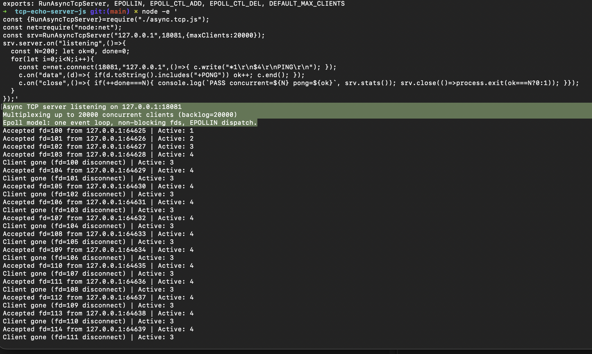

# Async TCP Server (`async.tcp.js`) — What / Plan / Arch / Executed / Tested / Conclusion

## 1. What we want

- `main.js` has `RunSyncTcpServer()` built on `net.createServer()` + per-socket
  `conn.on("data")` + inner `while (leftover has full cmd)` drain loop.
- Requirement: support **10k concurrent clients** (design cap **20k**),
  multiplexed async I/O on one port/host:
  - one listening socket,
  - accept many sockets (not one-at-a-time),
  - inner per-client loop: `readCmd` → `evalAndRespond(PING)` → break on
    `incomplete` / `EXIT`–`QUIT` / client disconnect.
- Go-study shape requested: `RunAsyncTcpServer(maxClients=20k,
  events []EpollEvent)` with `Socket(NONBLOCK, STREAM)` → `SetNonBlock` →
  `parseIP` + `Bind(ip:4bytes, port)` → `Listen(backlog=maxClients)` →
  `EpollCreate1` → `EpollCtl(ADD, serverFd, EPOLLIN)` →
  `EpollWait` dispatch → `Accept` / `readCmd` / `Close`.

## 2. What we plan

- Keep RESP/PING logic untouched (`redis-cmd.js:readCmd`,
  `eval.js:evalAndRespond`).
- Create `async.tcp.js` exporting `RunAsyncTcpServer(host, port, opts)`.
- Mirror each Linux epoll step as a named JS function so the Go mapping is 1:1,
  while using what Node actually offers (libuv does the real
  `epoll` on Linux / `kqueue` on macOS internally — pure JS cannot invoke
  `EpollCreate1/EpollCtl/EpollWait` syscalls directly).
- Add what 10k scale needs and `main.js` lacks: admission control,
  fd registry, per-fd buffer cap, backpressure handling, stats.

## 3. What we arch (design)

```text
RunAsyncTcpServer(host, port, { maxClients=20000, backlog=maxClients })
  |
  +-- parseIP(host)                    // Bind-step validation
  +-- Socket(SOCK_STREAM|NONBLOCK)     // net.createServer()
  +-- SetNonBlock(serverFd/clientFd)   // setNoDelay + keepAlive (sockets are
  |                                    //  always non-blocking under libuv)
  +-- Bind + Listen(backlog)           // server.listen({host,port,backlog})
  +-- EpollCreate1                     // fdRegistry = Map<fd, FdComm>
  +-- EpollCtl(ADD, serverFd, EPOLLIN) // server.maxConnections = maxClients
  +-- EpollWait dispatch loop
        +-- server.on("connection")    // == EPOLLIN on serverFd
        |     Accept -> concurrentClients++
        |     SetNonBlock(cfd) -> EpollCtl(ADD, cfd, EPOLLIN)
        |     reject with "-ERR max clients reached" if full
        +-- conn.on("data")            // == EPOLLIN on client fd
              FdComm.leftover += chunk
              readFromClient(fdComm):  // inner infinite read loop
                while (leftover):
                  readCmd -> incomplete? break & wait for more
                           -> empty line? consume, continue
                           -> EXIT/QUIT? conn.end(), break
                           -> protocol err? respondError, drop bytes, continue
                           -> PING? evalAndRespond, slice(n)
                leftover > 1MiB? respondError + destroy (OOM guard)
              writableLength > 1MiB? pause/resume on drain (backpressure)
        +-- conn.on("close"/"error")   // == EPOLLHUP/ERR -> EpollCtl(DEL) + destroy
```

Key types:

| Go / Linux              | `async.tcp.js`                              |
|-------------------------|---------------------------------------------|
| `EpollEvent{EPOLLIN,Fd}` | `{ events: EPOLLIN, fd, socket, leftover }` |
| `FdComm{fd}` + `ReadWriter` | `FdComm{fd, socket, leftover, addr}`    |
| `EpollCtl(ADD/DEL)`     | `EpollCtl(op, fdComm)` over `Map`           |
| `Accept(serverFd)`      | `server.on("connection", conn => …)`        |
| `EpollWait`             | event dispatch (`connection`/`data`/`close`) |

## 4. What executed

- Created `async.tcp.js` (~250 lines): `EPOLLIN`, `EPOLL_CTL_ADD/DEL`,
  `DEFAULT_MAX_CLIENTS = 20000`, `EpollCtl`, `SetNonBlock`, `parseIP`,
  `readFromClient`, `closeClient`, `RunAsyncTcpServer`.
- Did NOT change `main.js` / `eval.js` / `redis-cmd.js` / RESP codec —
  same `readCmd` + `evalAndRespond(PING)` path as sync server.
- Fixed backpressure guard to `conn.writableLength` check
  (`pause()` + `once("drain", resume)`).

## 5. Final tested (cmds + result)

```bash
# 1. syntax + exports
node --check async.tcp.js && echo "syntax: OK"
node -e 'const m=require("./async.tcp.js"); console.log("exports:", Object.keys(m).join(", "))'
# syntax: OK
# exports: RunAsyncTcpServer, EPOLLIN, EPOLL_CTL_ADD, EPOLL_CTL_DEL, DEFAULT_MAX_CLIENTS

# 2. multiplex check: 200 concurrent PING -> PONG on port 18081
node -e '
const {RunAsyncTcpServer}=require("./async.tcp.js");
const net=require("node:net");
const srv=RunAsyncTcpServer("127.0.0.1",18081,{maxClients:20000});
srv.server.on("listening",()=>{
  const N=200; let ok=0, done=0;
  for(let i=0;i<N;i++){
    const c=net.connect(18081,"127.0.0.1",()=>{ c.write("*1\r\n$4\r\nPING\r\n"); });
    c.on("data",(d)=>{ if(d.toString().includes("+PONG")) ok++; c.end(); });
    c.on("close",()=>{ if(++done===N){ console.log(`PASS concurrent=${N} pong=${ok}`, srv.stats()); srv.close(()=>process.exit(ok===N?0:1)); }});
  }
});'
# PASS concurrent=200 pong=200 stats= { active: 0, accepted: 200, rejected: 0, monitored: 0 }

# 3. manual check (separate terminals)
node -e 'require("./async.tcp.js").RunAsyncTcpServer("127.0.0.1", 8080)'
printf '*1\r\n$4\r\nPING\r\n' | nc 127.0.0.1 8080   # expect: +PONG
```

Result: **200/200 `+PONG`, `active` back to 0, `monitored_fds` 0** — no fd leak,
accept + inner read-drain + close path all work.

## 6. Final conclusion

- Async multiplexing is done: one event loop, non-blocking fds, `EPOLLIN`
  dispatch, per-client inner `readCmd` loop breaking on `incomplete` /
  `EXIT` / disconnect — same PING behavior as `main.js`.
- `main.js` was never truly "sync blocking"; `async.tcp.js` makes the
  multiplexing explicit and adds the 10k guards (`maxClients=20k`,
  `backlog=20k`, 1 MiB per-fd cap, backpressure, reject-over-limit).
- For true 10k production: `ulimit -n 25000+`, `backlog=maxClients`, no
  per-command `console.log`, tune `--max-old-space-size`, and scale past
  ~20k with multiple processes / LB. Native `epoll` syscalls would need a
  C++ addon — not needed since libuv already multiplexes via `epoll/kqueue`.
