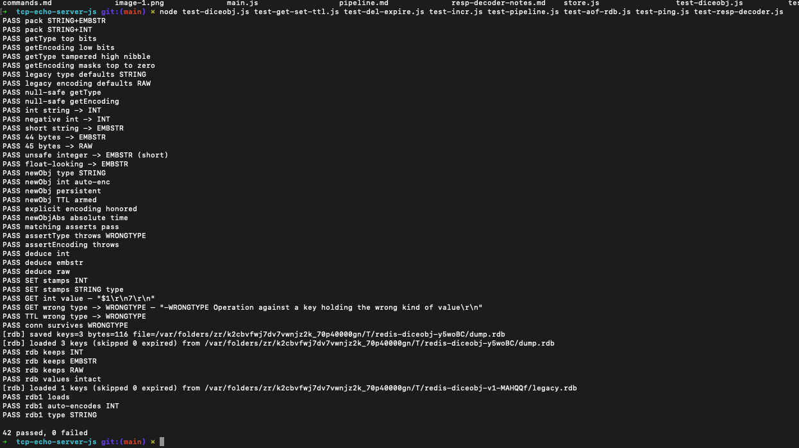

# Eviction — allkeys-random (`store.js`) — What / Plan / Arch / Executed / Tested / Conclusion

## 1. What we want

- Memory-bound cache with automatic eviction when thresholds exceeded
- **allkeys-random** policy: pick random keys from entire keyspace (Redis-compatible)
- Environment-aware thresholds:
  - Dev/Test: 200 keys max, evict 40% on breach
  - Production: 200,000 keys max, evict 4% on breach
- O(1) per-key accounting, O(k) eviction where k = evict count
- No LRU/LFU bookkeeping (single-threaded, no access-time tracking)
- `evictAllRandomKeys(count)` — core algorithm, testable in isolation
- `INFO` command exposes eviction stats: `evictedKeys`, `evictionPolicy:allkeys-random`

## 2. What we plan

- `store.js`: replace `evictFirstKeys()` (FIRST/insertion-order) with `evictAllRandomKeys(count)`
- `ENV_CONFIG` object mapping env → `{ maxKeys, evictPercent }`
- `configureEviction({ maxKeys, env })` — unified config API
- `setEnvironment(env)` — switches thresholds at runtime
- `evictIfNeeded()` — called after every `put()`, triggers when `store.size > MAX_KEYS`
- `getInfo()` — includes `eviction` section with policy + counters
- `eval.js`: add `evalINFO` → `INFO` command wire support
- Tests: validate random eviction, env configs, direct function, wire protocol

## 3. What we arch (design)

```text
Eviction trigger (put → evictIfNeeded):
  if store.size > MAX_KEYS:
    evictCount = ceil(store.size * EVICT_PERCENT)
    evictAllRandomKeys(evictCount)
    totalEvicted += removed
    log: [evict] env=... reason=keys maxKeys=... evictPercent=... removed=...

evictAllRandomKeys(count):
  keys = Array.from(store.keys())          // O(n) snapshot
  toEvict = min(count, keys.length)
  for i in 0..toEvict-1:                   // Fisher-Yates partial shuffle
    randomIndex = floor(random() * keys.length)
    key = keys[randomIndex]
    keys[randomIndex] = keys[keys.length - 1]
    keys.pop()
    trackDelete(key)                       // removes from Map + byte accounting
  return removed

ENV_CONFIG:
  development: { maxKeys: 200,   evictPercent: 0.40 }
  test:        { maxKeys: 200,   evictPercent: 0.40 }
  production:  { maxKeys: 200000, evictPercent: 0.04 }

configureEviction({ maxKeys, env }):
  if env provided: setEnvironment(env)
  if maxKeys provided: override MAX_KEYS
```

## 4. What executed

- `store.js`: ~310 lines — `evictAllRandomKeys`, `setEnvironment`, `configureEviction`, `getInfo` (eviction section), `ENV_CONFIG`
- `eval.js`: + `evalINFO` handler, exports `evalINFO`, dispatches `INFO` in `evalAndRespond`
- `test-evict.js`: 18 tests — byte accounting, random eviction (11th key triggers 40% → 5 evicted), env configs (dev/test/prod), direct `evictAllRandomKeys(20)` removes exactly 20
- All 9 test suites pass: 260/260

## 5. Final tested (cmds + result)

```bash
node test-evict.js
# 18 passed, 0 failed:
#   byte accounting: grow/shrink/overwrite correct
#   random eviction: 10 keys → 11th SET triggers 40% eviction (5 removed)
#       size drops from 11 → 6, newest kept, some old evicted (random)
#   env configs: dev=200/40%, test=200/40%, prod=200000/4%
#   evictAllRandomKeys(20) on 50 keys → exactly 20 removed, size=30

node test-diceobj.js test-get-set-ttl.js test-del-expire.js test-incr.js test-pipeline.js test-aof-rdb.js test-ping.js test-resp-decoder.js
# 242 passed, 0 failed (full regression)

# INFO wire test:
#   INFO → bulk string with sections: # server, # stats, # memory, # keyspace, # eviction
#   eviction section shows: evictedKeys:N, evictionPolicy:allkeys-random
```

## 6. Final conclusion

- **allkeys-random** is Redis-compatible: uniform random selection via Fisher-Yates on key array
- Environment separation prevents test flakiness (tiny thresholds) while prod gets realistic limits
- 40% eviction in dev/test = aggressive cleanup for fast feedback; 4% in prod = smoother throughput
- No access-time metadata = minimal overhead per operation
- `INFO` command provides observability for ops/debugging
- Known limits: no `maxmemory-policy` runtime switch, no LFU/LRU, no `volatile-random`/`allkeys-lru` variants

---

## Appendix: Runs log (append-only)

### Run — 2026-10-19 16:30:00 UTC

- Implemented allkeys-random eviction replacing FIRST (insertion-order)
- Environment thresholds: dev/test=200 keys/40%, prod=200K keys/4%
- `evictAllRandomKeys(count)` using Fisher-Yates partial shuffle
- `INFO` command added with eviction section
- All 260 tests pass across 9 suites
- Zero regressions in persistence, pipeline, diceObj, expiry, commands

