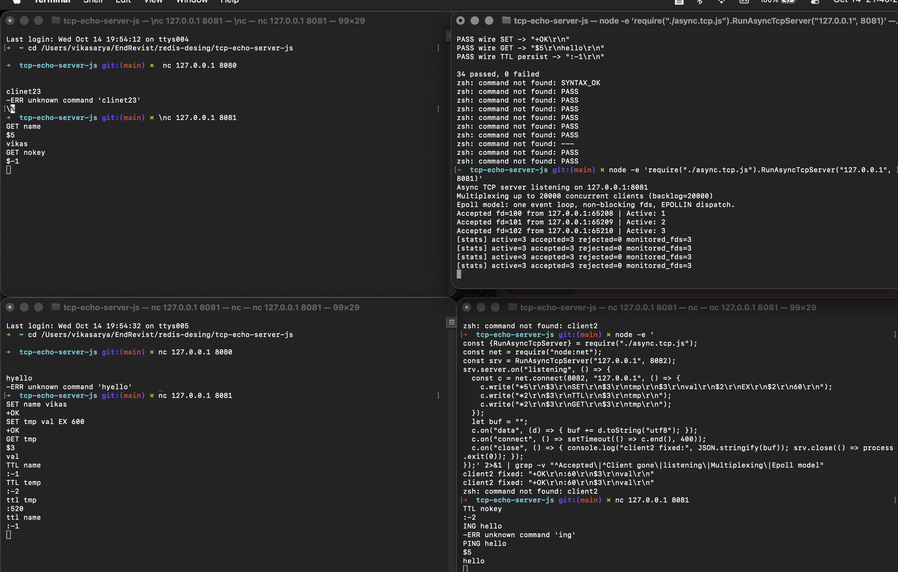

# Redis Cmd Impl — GET / SET / TTL (`redis_cmd_impl.md`)

Spec-first: this file is the contract. `store.js` + `eval.js` changes must match it.

## 1. Goal

Add `GET` / `SET` / `TTL` to `evalAndRespond()`'s `switch`, same as `PING`:

```js
switch (redisCmd.Cmd.toUpperCase()) {
    case "PING": out = evalPING(args, conn); break;
    case "SET":  out = evalSET(args, conn);  break;
    case "GET":  out = evalGET(args, conn);  break;
    case "TTL":  out = evalTTL(args, conn);  break;
    default:     out = evalDefault(redisCmd, conn);
}
```

Rule (matches existing `evalPING` shape): each `eval*` **writes the reply
itself** via `conn.write()` and **returns the Buffer** (for tests).
The dispatcher does **not** write again (see §6 drive-by fix).

## 2. Store (`store.js`, new file)

```js
// Obj struct: { value: string, expireAt: number }
//   expireAt = epoch-ms when the key dies, -1 = persistent (no expiry).
// store: Map<string, Obj>, created once at module load (init).
```

| Function | Signature | Behaviour |
|---|---|---|
| `newObj` | `(value, durationMs) -> Obj` | `durationMs > 0` → `expireAt = Date.now() + durationMs`, else `expireAt = -1` |
| `put` | `(key, obj) -> void` | `store.set(key, obj)` (overwrite) |
| `get` | `(key) -> Obj \| null` | missing → `null`; **expired** (`expireAt !== -1 && Date.now() > expireAt`) → lazy `delete` + `null`; else the `Obj` |
| `del` | `(key) -> boolean` | `store.delete(key)` (helper, expiry tests) |

Lazy expiry only (no background sweeper — out of scope).

## 3. `evalSET(args, conn)` — `SET key value [EX seconds] [PX ms]`

Parse: `args[0]` = key, `args[1]` = value, `expiryMs = -1` default,
loop `i` from 2:

- token `EX` (case-insensitive): needs `args[i+1]`, integer seconds → `expiryMs = s * 1000`, `i += 2`
- token `PX` (case-insensitive): needs `args[i+1]`, integer milliseconds → `expiryMs = ms`, `i += 2`
- anything else → error `syntax error`

Errors (reply `-ERR …`, connection stays open):

| Condition | Message |
|---|---|
| `args.length < 2` | `wrong number of arguments for 'set' command` |
| unknown token / missing EX/PX value | `syntax error` |
| EX/PX value not an integer | `value is not an integer or out of range` |
| EX/PX value `<= 0` | `invalid expire time in 'set' command` |

Success: `put(key, newObj(value, expiryMs))`, reply `+OK\r\n`.

Wire examples:

```text
SET name vikas            -> +OK
SET name vikas EX 10      -> +OK   (dies after 10 s)
SET k v EX abc            -> -ERR value is not an integer or out of range
SET k v                   -> -ERR wrong number of arguments for 'set' command  (only 1 arg)
SET k v FOO               -> -ERR syntax error
```

## 4. `evalGET(args, conn)` — `GET key`

- `args.length !== 1` → `wrong number of arguments for 'get' command`
- `obj = get(key)`; `obj === null` (missing **or expired**) → `$-1\r\n` (RESP nil — `EncodeBulkString(null)`)
- else → `EncodeBulkString(String(obj.value))`

```text
SET name vikas  -> +OK
GET name        -> $5\r\nvikas\r\n
GET nokey       -> $-1\r\n
GET k (after EX elapsed) -> $-1\r\n   (lazy-expired on read)
```

## 5. `evalTTL(args, conn)` — `TTL key`

- `args.length !== 1` → `wrong number of arguments for 'ttl' command`
- `obj = get(key)`; `null` → `:-2\r\n` (key does not exist)
- `obj.expireAt === -1` → `:-1\r\n` (exists, persistent)
- else → remaining whole seconds, `Math.ceil((expireAt - Date.now()) / 1000)` (`:<n>\r\n`, `EncodeInteger`)
  - `ceil` so a fresh `SET k v EX 10` reports `10`, matching user expectation.
  - if remaining `<= 0` between check and reply, treat as expired → `:-2\r\n`.

```text
SET k v EX 100  -> +OK
TTL k           -> :100
SET p v         -> +OK
TTL p           -> :-1
TTL nokey       -> :-2
```

## 6. Drive-by fix (required for `redis-benchmark` correctness)

Today `evalPING`/`evalDefault` write the reply **and** `evalAndRespond`
writes the returned buffer **again** → every command sends its reply
**twice** (`+PONG\r\n+PONG\r\n`), which corrupts pipelined benchmark
streams. Fix: dispatcher only calls the `eval*` fn (single write inside
each fn). Existing `test-ping.js` asserts on `last()` write only, so it
still passes — plus a new no-double-write assertion in the TTL test file.

## 7. Test plan (`test-get-set-ttl.js`, same `fakeConn` style as `test-ping.js`)

- SET happy paths: plain, `EX 100` (TTL≈100), `PX 60000` (TTL≈60), lowercase `ex`
- SET errors: 0/1 args, `EX` w/o value, `EX abc`, `EX 0`/`EX -5`, trailing junk
- GET: round-trip, missing → `$-1`, expired (pre-aged `put(key, newObj(v,-1000))` — deterministic, no sleeps) → `$-1`
- TTL: `-2` missing, `-1` persistent, `~100` for `EX 100`, `-2` for pre-aged key
- Dispatch: `evalAndRespond({Cmd:"SET"…})` / `GET` / `TTL` (+ lowercase) each produce **exactly one** write
- Regression: `node test-ping.js`, `node test-resp-decoder.js`, `node --check` all files
