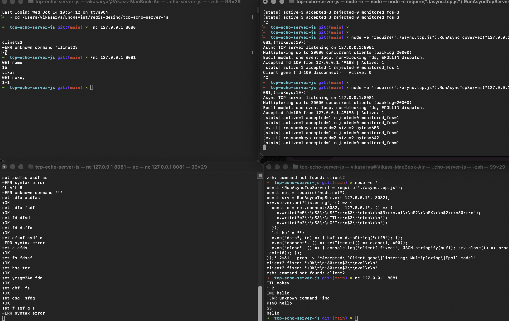

# Redis Cmd Impl — GET / SET / TTL (`redis_cmd_impl.md`)

Spec-first: this file is the contract. `store.js` + `eval.js` changes must match it.

## 1. Goal

Add `GET` / `SET` / `TTL` to `evalAndRespond()`'s `switch`, same as `PING`:

```js
switch (redisCmd.Cmd.toUpperCase()) {
    case "PING": out = evalPING(args, conn); break;
    case "SET":  out = evalSET(args, conn);  break;
    case "GET":  out = evalGET(args, conn);  break;
    case "TTL":  out = evalTTL(args, conn);  break;
    default:     out = evalDefault(redisCmd, conn);
}
```

Rule (matches existing `evalPING` shape): each `eval*` **writes the reply
itself** via `conn.write()` and **returns the Buffer** (for tests).
The dispatcher does **not** write again (see §6 drive-by fix).

## 2. Store (`store.js`, new file)

```js
// diceObj struct (redisObject port): { value: string, expireAt: number, typeEncoding: uint8 }
//   expireAt = epoch-ms when the key dies, -1 = persistent (no expiry).
//   typeEncoding = [ type: high 4 bits | encoding: low 4 bits ] (robj layout).
//   type: OBJ_TYPE_STRING (0). encoding: RAW (0) | INT (1) | EMBSTR (2, ≤44 B).
// store: Map<string, diceObj>, created once at module load (init).
```

| Function | Signature | Behaviour |
|---|---|---|
| `newObj` | `(value, durationMs, otype=STRING, oEnc=auto) -> diceObj` | `durationMs > 0` → `expireAt = Date.now() + durationMs`, else `expireAt = -1`; encoding auto-detects (int → INT, ≤44 B → EMBSTR, else RAW) unless passed |
| `newObjAbs` | `(value, expireAt, otype=STRING, oEnc=auto) -> diceObj` | absolute-expiry twin for loaders (RDB) and tests |
| `packTypeEncoding` | `(otype, oEnc) -> uint8` | `(otype & 0x0F) << 4 \| (oEnc & 0x0F)` |
| `getType` / `getEncoding` | `(diceObj) -> nibble` | `(byte >> 4) & 0x0F` / `byte & 0x0F`; legacy objs without the byte read as STRING / RAW |
| `assertType` / `assertEncoding` | `(diceObj, expected)` | throw on mismatch (`WRONGTYPE …` for type); `GET`/`TTL`/`INCR` catch → `-WRONGTYPE` on the wire |
| `deduceTypeEncoding` | `(value) -> { otype, oEnc }` | Redis `tryObjectEncoding` port: `SET`/`INCR` call this before storing; today always `{ STRING, autoEncoding(value) }`, future types extend here |
| `put` | `(key, diceObj) -> void` | `store.set(key, diceObj)` (overwrite) |
| `get` | `(key) -> diceObj \| null` | missing → `null`; **expired** (`expireAt !== -1 && Date.now() > expireAt`) → lazy `delete` + `null`; else the `diceObj` |
| `del` | `(key) -> boolean` | `store.delete(key)` (helper, expiry tests) |
| `clearStore` | `() -> void` | drop everything + reset byte accounting (restart simulation) |

Lazy expiry only (no background sweeper — out of scope).

## 3. `evalSET(args, conn)` — `SET key value [EX seconds] [PX ms]`

Parse: `args[0]` = key, `args[1]` = value, `expiryMs = -1` default,
loop `i` from 2:

- token `EX` (case-insensitive): needs `args[i+1]`, integer seconds → `expiryMs = s * 1000`, `i += 2`
- token `PX` (case-insensitive): needs `args[i+1]`, integer milliseconds → `expiryMs = ms`, `i += 2`
- anything else → error `syntax error`

Errors (reply `-ERR …`, connection stays open):

| Condition | Message |
|---|---|
| `args.length < 2` | `wrong number of arguments for 'set' command` |
| unknown token / missing EX/PX value | `syntax error` |
| EX/PX value not an integer | `value is not an integer or out of range` |
| EX/PX value `<= 0` | `invalid expire time in 'set' command` |

Success: `put(key, newObj(value, expiryMs))`, reply `+OK\r\n`.

Wire examples:

```text
SET name vikas            -> +OK
SET name vikas EX 10      -> +OK   (dies after 10 s)
SET k v EX abc            -> -ERR value is not an integer or out of range
SET k v                   -> -ERR wrong number of arguments for 'set' command  (only 1 arg)
SET k v FOO               -> -ERR syntax error
```

## 4. `evalGET(args, conn)` — `GET key`

- `args.length !== 1` → `wrong number of arguments for 'get' command`
- `obj = get(key)`; `obj === null` (missing **or expired**) → `$-1\r\n` (RESP nil — `EncodeBulkString(null)`)
- else → `EncodeBulkString(String(obj.value))`

```text
SET name vikas  -> +OK
GET name        -> $5\r\nvikas\r\n
GET nokey       -> $-1\r\n
GET k (after EX elapsed) -> $-1\r\n   (lazy-expired on read)
```

## 5. `evalTTL(args, conn)` — `TTL key`

- `args.length !== 1` → `wrong number of arguments for 'ttl' command`
- `obj = get(key)`; `null` → `:-2\r\n` (key does not exist)
- `obj.expireAt === -1` → `:-1\r\n` (exists, persistent)
- else → remaining whole seconds, `Math.ceil((expireAt - Date.now()) / 1000)` (`:<n>\r\n`, `EncodeInteger`)
  - `ceil` so a fresh `SET k v EX 10` reports `10`, matching user expectation.
  - if remaining `<= 0` between check and reply, treat as expired → `:-2\r\n`.

```text
SET k v EX 100  -> +OK
TTL k           -> :100
SET p v         -> +OK
TTL p           -> :-1
TTL nokey       -> :-2
```

## 6. Drive-by fix (required for `redis-benchmark` correctness)

Today `evalPING`/`evalDefault` write the reply **and** `evalAndRespond`
writes the returned buffer **again** → every command sends its reply
**twice** (`+PONG\r\n+PONG\r\n`), which corrupts pipelined benchmark
streams. Fix: dispatcher only calls the `eval*` fn (single write inside
each fn). Existing `test-ping.js` asserts on `last()` write only, so it
still passes — plus a new no-double-write assertion in the TTL test file.

## 7. Test plan (`test-get-set-ttl.js`, same `fakeConn` style as `test-ping.js`)

- SET happy paths: plain, `EX 100` (TTL≈100), `PX 60000` (TTL≈60), lowercase `ex`
- SET errors: 0/1 args, `EX` w/o value, `EX abc`, `EX 0`/`EX -5`, trailing junk
- GET: round-trip, missing → `$-1`, expired (pre-aged `put(key, newObj(v,-1000))` — deterministic, no sleeps) → `$-1`
- TTL: `-2` missing, `-1` persistent, `~100` for `EX 100`, `-2` for pre-aged key
- Dispatch: `evalAndRespond({Cmd:"SET"…})` / `GET` / `TTL` (+ lowercase) each produce **exactly one** write
- Regression: `node test-ping.js`, `node test-resp-decoder.js`, `node --check` all files


## 8. `evalDEL(args, conn)` — `DEL key [key ...]` → `:deleted-count`

- `args.length < 1` → `wrong number of arguments for 'del' command`
- per key: `get(k) !== null` (lazy `get` treats expired as absent) → raw `store.delete(k)` + `count++`
- reply `EncodeInteger(count)` — `:0` when nothing deleted (not an error)

```text
SET a 1 + SET b 2  -> +OK +OK
DEL a b missing    -> :2
DEL missing        -> :0
DEL                -> -ERR wrong number of arguments for 'del' command
```

## 9. `evalEXPIRE` / `evalPEXPIRE` — `EXPIRE key seconds` / `PEXPIRE key ms` → `:1` / `:0`

Both share one parser; EX multiplies seconds × 1000. Errors (reply `-ERR …`, connection stays open):

| Condition | Message |
|---|---|
| `args.length !== 2` | `wrong number of arguments for 'expire' command` (`'pexpire'` for PEXPIRE) |
| value not an integer | `value is not an integer or out of range` |
| key missing **or already expired** | `:0` (not an error — real Redis) |
| value `<= 0` | delete key immediately, `:1` (real Redis) |

Success: `setExpire(key, ms)` keeps the value, sets `expireAt = now + ms`; reply `:1`. Afterwards `TTL key` ≈ requested seconds.

```text
SET k v          -> +OK
EXPIRE k 100     -> :1
TTL k            -> :100
EXPIRE nokey 10  -> :0
EXPIRE k 0       -> :1   (k gone; GET k -> $-1)
```

## 10. Active expiry cron (single-threaded, Redis-style)

Lazy `get()` alone leaves never-read dead keys in memory forever. The async
server therefore sweeps on a timer (Go: `serverCron` → `activeExpireCycle`;
here: `setInterval` in `RunAsyncTcpServer`, next to the stats timer):

```js
const DEFAULT_CRON_FREQUENCY_MS = 1000;   // 1 s, 1 run (real Redis: 10 Hz)
let lastCronExecution = 0;                // epoch-ms of last sweep
const cronTimer = setInterval(() => {
    const deleted = DeleteExpiredKeys();  // core sweep (store.js)
    lastCronExecution = Date.now();
    if (deleted > 0) console.log(`[cron] expired ${deleted} keys`);
}, opts.cronFrequency ?? DEFAULT_CRON_FREQUENCY_MS);
cronTimer.unref();                        // never keep the process alive
// clearInterval(cronTimer) on server close; lastCronExecution in stats()
```

`store.js` additions:

| Function | Behaviour |
|---|---|
| `setExpire(key, durationMs)` | `get(key)` first (lazy-cleans) → `null` returns `false`; else mutate live `Obj.expireAt = Date.now() + ms`, return `true` |
| `expireSample()` | scan unordered `Map`, take up to `EXPIRE_SAMPLE_SIZE = 20` keys with `expireAt !== -1`, delete the expired ones → `{ sampled, expired }` |
| `DeleteExpiredKeys()` | `loop { s = expireSample(); if (s.sampled === 0) break; frac = s.expired / s.sampled; log; if (frac < 0.25) break; }` (max 3 passes/tick to bound single-thread block time) → total deleted |

Why sample + `frac < 0.25` break (not full scan): a full `Map` scan every
second is O(n) on the event loop and stalls all 20k clients at large key
counts. Sampling 20 keeps each tick O(1); repeating while `frac >= 0.25`
sweeps harder exactly when many keys are dying. `main.js` (sync) is
intentionally unwired — same shared `store` module, one-line call enables it later.

## 11. Test plan (`test-del-expire.js`)

- DEL: `DEL a b missing` → `:2`; all-missing → `:0`; 0 args → error; expired key → counts 0; dispatch single-write
- EXPIRE/PEXPIRE: happy `:1` + visible via `TTL`; missing → `:0`; `abc` → not-integer; `0`/`-5` → key gone + `:1`; wrong arg counts
- `DeleteExpiredKeys()` direct: seeded live + pre-aged keys → expired gone / live kept; all-live store → single pass, returns 0
- Active proof: `SET k v PX 40`, **zero reads**, wait ~1.2 cron ticks → `store.has("k") === false` (only the cron could remove it)
- Regression: `node --check` all files + `test-ping.js` + `test-resp-decoder.js` + `test-get-set-ttl.js` green; append run to `load_test.md`

## 12. Eviction policy — simple FIRST eviction (no LRU/LFU approx)

Simplest possible policy: when the cache hits a threshold, iterate the
unordered `Map` (insertion order = oldest first) and delete from the front.
No sampling, no frequency counters — LRU/LFU explicitly out of scope.

Thresholds (two triggers, either one fires eviction):

| Trigger | Default | Terminal-test override |
|---|---|---|
| max key count (`store.size`) | `20_000` keys | `maxKeys: 10` |
| max cache bytes (keys + values + per-entry overhead) | `10 MB` | not overridden (see note) |

On breach, after the triggering `put()`:

- count trigger (`size > MAX_KEYS`): delete first `ceil(size * 0.10)` keys (10%).
- size trigger (`bytes > MAX_BYTES`): delete from the front until freed ≥ 1% of `MAX_BYTES`, or 10% of keys scanned — whichever comes first.
- log every eviction: `[evict] reason=keys|bytes removed=N size=… bytes=…`.

```js
// store.js
let MAX_KEYS = 20_000, MAX_BYTES = 10 * 1024 * 1024;
function configureEviction({ maxKeys, maxBytes } = {}) { … } // server startup / tests
function evictIfNeeded() { … }                              // called at end of put()
function evictFirstKeys(n) { … }                            // delete n oldest-inserted
```

Size accounting: `currentBytes` maintained incrementally — `put` adds
`byteLength(key) + byteLength(value) + 64 (entry overhead, approximation)`,
every delete path (`del`, lazy `get`, `expireSample`, `DeleteExpiredKeys`)
subtracts via one shared `trackDelete()`. `setExpire` changes no bytes.

Wiring: `RunAsyncTcpServer(host, port, { maxKeys, maxCacheBytes })` calls
`configureEviction()` at startup (sync `main.js` inherits the check free via
shared `put()`). Terminal test:

```bash
node -e 'require("./async.tcp.js").RunAsyncTcpServer("127.0.0.1",8081,{maxKeys:10})'
# nc: SET k1..k11 → 11th SET evicts first 2 (10% of 11); GET k1 → $-1, GET k11 → value
```

NOTE: the 10 MB path is coded (with comments) but has NO automated test —
filling 10 MB in unit tests is slow/flaky; verify by reasoning + the shared
`evictFirstKeys` path it uses. `test-evict.js` covers the count path only
(small `maxKeys`, assert oldest 10% gone, newest kept, no-evict below limit).

## 13. `evalINCR(args, conn)` — `INCR key` → `:new-value`

- `args.length !== 1` → `wrong number of arguments for 'incr' command`
- `get(key)` first (lazy `get`: missing **or expired** → `null` → start at 0,
  so `INCR new` → `:1` and stores `"1"`).
- Live key: `assertType(obj, STRING)` → `-WRONGTYPE` on mismatch;
  value must match `/^-?\d+$/` and be a safe integer, else
  `value is not an integer or out of range` (value left untouched);
  `n + 1` past safe integer → `increment or decrement would overflow`.
- Success mutates in place: `obj.value = String(n + 1)` — **TTL untouched** —
  then re-runs `deduceTypeEncoding` (tryObjectEncoding) and re-stamps
  `typeEncoding`, keeping the pre-existing type nibble. Reply
  `EncodeInteger(next)`.
- AOF logs `INCR` verbatim (replay re-increments from the same base state,
  so it converges — same as Redis). RDB needs nothing new (plain string).

```text
INCR hits        -> :1        (new key stored as "1", INT encoding)
SET c 41 + INCR c -> :42      (TTL, if any, preserved)
INCR str("hi")   -> -ERR value is not an integer or out of range
INCR max(2^53-1)-> -ERR increment or decrement would overflow
```

Test plan (`test-incr.js`): missing → `:1` + `"1"` + INT stamp; 41 → `:42`
→ `:43`; `-1` → `:0`; non-int / unsafe-int / overflow errors (value kept);
0/2-arg arity; expired → `:1`; TTL preserved (`TTL` ≈ 60 after `INCR`);
tampered type → `-WRONGTYPE`; lowercase dispatch; AOF verbatim frames +
replay `SET 5, INCR, INCR` → `"7"`.

