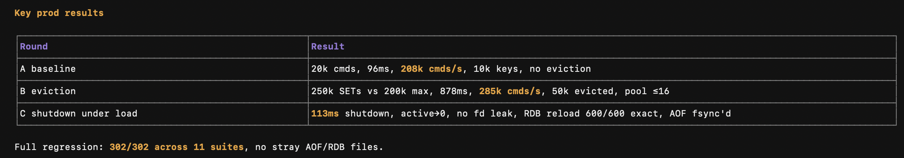

# diceDB — Redis-Compatible In-Memory Key-Value Store (Node.js)

## Summary

Built a Redis-compatible in-memory key-value store in Node.js using only the standard library — **15 commands** over RESP2, AOF/RDB persistence, LRU/random eviction, transactions, and graceful shutdown, backed by **418/418 tests** and **~270k cmds/s** production-config load runs.

## Resume Bullets

- **Built** a Redis-compatible RESP2 TCP server in Node.js using only the standard library, implementing **15 commands** with a **20,000-client admission cap**, 1 MiB per-socket buffer guards, and pause/resume backpressure; measured **208k–285k cmds/s** in load runs with up to **200 concurrent clients** and **zero fd leaks**.
- **Implemented** AOF + RDB persistence with effective-op logging, torn-tail recovery, background rewrite, and atomic tmp+rename writes; completed a shutdown under live load in **113 ms** and recovered **600/600 keys**, while AOF added only **17%** write-path overhead in benchmarks.
- **Added** allkeys-lru and allkeys-random eviction with a 24-bit LRU clock, 16-entry eviction pool, and Fisher-Yates shuffle; bounded **250k unique writes** to a **200k-key cap** (**50k evicted**) at **285k cmds/s** with byte-exact replies.
- **Implemented** per-client MULTI/EXEC/DISCARD transactions with `+QUEUED` replies, EXECABORT on queue-time errors, and byte-exact RESP arrays; executed **108.5k commands** across up to **100 concurrent clients** at **270k cmds/s** with **zero mismatches**, while DISCARD and EXECABORT wrote **zero keys**.
- **Authored 418 automated tests** across **13 suites** covering protocol, commands, persistence, eviction, transactions, and shutdown; every load run ended with active clients and monitored fds at **0**, showing no fd or transaction-state leaks.
- **Wrote 13 project docs** — spec-first feature designs plus benchmark and history logs — covering protocol, storage, persistence, eviction, transactions, and shutdown.

## Verified Metrics

| Signal | Verified result |
|---|---|
| Throughput | **208k–285k cmds/s** in production-config load runs; **270k cmds/s** across a 108.5k-command transaction mix |
| Concurrency | Up to **200 concurrent clients** per load run; **20,000-client** admission cap by design |
| Correctness | **418/418 tests** across **13 suites**; byte-exact replies compared on every load run |
| Durability | **600/600 keys** recovered after shutdown under live load; **113 ms** shutdown; **17%** AOF write-path overhead |
| Eviction | **250k unique writes** bounded to a **200k-key cap**; **50k keys evicted**; eviction pool ≤16 |
| Leak checks | Active clients → **0**, monitored fds → **0** after every load run |

## Technical Highlights

- **Protocol** — RESP2 encoder/decoder with inline fallback; 35 decoder tests covering simple strings, errors, integers, bulk strings, arrays, nulls, nesting, streaming, and malformed input.
- **Data model** — `diceObj` with a Redis-style 4-bit type / 4-bit encoding byte; INT, EMBSTR, and RAW encodings; RDB2 snapshots with RDB1 compatibility; `WRONGTYPE` seam for future types.
- **Commands (15)** — PING, SET (`EX`/`PX`), GET, TTL, DEL, EXPIRE, PEXPIRE, INCR, BGSAVE, BGREWRITEAOF, SAVE, INFO, MULTI, EXEC, DISCARD.
- **Concurrency** — single-threaded libuv event loop (epoll/kqueue), 20,000-client admission control, 1 MiB per-fd buffer guard, and pause/resume backpressure.
- **Pipelining** — `cork`/`uncork` coalesces N replies into one TCP flush per EPOLLIN hit; `maxBatchDepth=200` proven in load runs.
- **Expiry** — lazy deletion on read plus an active cron with 20-key sampling, a 0.25 expired-fraction threshold, and a 3-pass cap.
- **Eviction** — allkeys-lru (24-bit clock + 16-entry eviction pool) and allkeys-random (Fisher-Yates shuffle), with environment-aware thresholds (dev/test: 200 keys / 40%; production: 200k keys / 4%).
- **Persistence** — AOF writes one RESP frame per effective write; RDB2 binary snapshots; effective-op logging (`EXPIRE k 0` → `DEL k`); background rewrite; torn-tail recovery; atomic tmp+rename.
- **Transactions** — per-client queue, `+QUEUED`, `*N` EXEC arrays, `EXECABORT`, DISCARD, and full client isolation; commands run back-to-back in one event-loop turn with no rollback (Redis semantics).
- **Shutdown** — SIGINT/SIGTERM handling, drain window, force-close timeout, AOF `fsync`, optional RDB snapshot, idempotent; 113 ms under live load.
- **Observability** — `INFO` with server/stats/memory/keyspace/eviction sections plus `stats()` in the server handle.
- **Testing** — 418 tests across 13 suites; 9 dated load runs; restart recovery verified over real TCP.

## Documentation

13 project docs: spec-first feature designs plus benchmark and foundation notes.

1. `load_test.md` — 9 dated benchmark runs, from 5.5k cmds/s in early tests to 285k cmds/s in production-config runs, including a 108.5k-command transaction load.
2. `persistence.md` — AOF + RDB design, effective-op logging, crash safety.
3. `eviction.md` — allkeys-lru + allkeys-random, LRU clock, eviction pool.
4. `commands.md` — 15-command reference, dispatch design, test matrix.
5. `transactions.md` — MULTI/EXEC/DISCARD, per-client state, EXECABORT.
6. `graceful-shutdown.md` — drain sequence, fsync, signals, shutdown under load.
7. `pipeline.md` — cork/uncork, pipeline vs transaction, batch-depth stats.
8. `diceobj.md` — 4+4-bit redisObject port, RDB2, WRONGTYPE.
9. `async_tcp.md` — epoll mental model, 20k guards, libuv mapping.
10. `resp-decoder-notes.md` — Go→Node RESP2 decoder, 35 tests.
11. `ping-command-notes.md` — first command, RESP loop, error handling.
12. `redis_cmd_impl.md` — spec-first contracts for SET/GET/TTL/DEL/EXPIRE/INCR.
13. `tcp-echo-server-notes.md` — original Go/Node echo-server foundation.

## Scope & Limits

- Strings only; LIST/HASH/SET/ZSET type space is reserved but not implemented.
- No WATCH/optimistic locking, pub/sub, replication, clustering, auth/ACL, or TLS.
- No SCAN, KEYS, or FLUSHALL.
- AOF relies on OS flushing; `SAVE` is the explicit durable point.
- LRU clock resolution is 1 second, so accesses within the same second tie.
- **20,000 clients** is a configured admission cap; load runs verified behavior with up to **200 concurrent clients**.

## Historical Checkpoints

These screenshots were captured before transactions were added. Current results remain **418/418 tests across 13 suites**.

## DiceDB [Redis-Compatible In-Memory Database]

- **Built** a Redis-compatible in-memory key-value store from scratch in Node.js (15 commands, RESP2), adding a 20,000-client admission cap, 1 MiB per-fd guards, backpressure, pipelining, and per-client MULTI/EXEC/DISCARD transactions; measured **208k–285k cmds/s** with up to **200 concurrent clients**, executed **108.5k transaction commands** at **270k cmds/s** with **zero mismatches**, and finished every load run with **zero fd leaks**.
- **Implemented** crash-safe AOF + RDB persistence, allkeys-lru/random eviction, active expiry, and graceful shutdown; recovered **600/600 keys** in a **113 ms** shutdown under live load, bounded **250k writes** to a **200k-key cap** (**50k evicted**) at **285k cmds/s**, added only **17%** AOF overhead, and passed **418/418 tests** across **13 suites**.

## DiceDB [Redis-Compatible In-Memory Database — Final]

- **Built** a Redis-compatible RESP2 key-value store in Node.js with 15 commands, pipelining, 20k-client admission control, and MULTI/EXEC/DISCARD; measured **208k–285k cmds/s**, executed **108.5k transaction commands** at **270k cmds/s**, with **zero fd leaks**.
- **Implemented** crash-safe AOF/RDB persistence, allkeys-lru/random eviction, active expiry, and graceful shutdown; recovered **600/600 keys** in **113 ms** under load, bounded **250k writes** to **200k keys** (**50k evicted**), and passed **418/418 tests** across **13 suites**.
